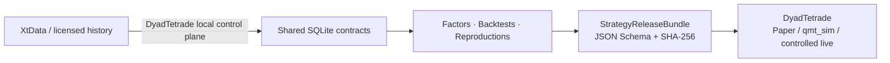

# DyadResearch

DyadResearch 是一个面向 A 股的独立研究平台：管理只读历史数据契约，完成因子研究、策略研究、严格事件驱动回测、实验复现与报告生成。它不包含账户、委托、撤单或 `XtTrader` 能力。

可信度来自可执行边界与证据，而不是界面数字：源 SQLite 始终只读；财务数据按公告时点可见；成交默认发生在下一根可交易 Bar；公司行动、T+1、涨跌停、停牌、费用和复权均有测试；同一输入保存数据指纹和结果哈希。公开仓库只使用固定规则生成的 `SYNTHETIC DATA`，不携带网盘数据库、QMT 缓存或供应商行情。

## 5 分钟运行

```powershell
py -3.12 -m venv .venv
.venv\Scripts\python -m pip install -e ".[research,web,dev]"
.venv\Scripts\dyadresearch demo generate-data
.venv\Scripts\dyadresearch doctor
.venv\Scripts\dyadresearch factor run --name momentum_20 --symbols 000001.SZ --period 1d --start 20240102 --end 20240325
.venv\Scripts\dyadresearch backtest run --strategy buy_and_hold --symbols 000001.SZ --period 1d --start 20240102 --end 20240325
.venv\Scripts\dyadresearch reproduce run reproductions/specs/momentum.yaml
```

启动研究 API：

```powershell
.venv\Scripts\dyadresearch-web
```

前端位于 `frontend/`，使用 `pnpm install --frozen-lockfile`、`pnpm run test`、`pnpm run lint` 和 `pnpm run build`。本地私有配置可由 `config/research.example.yaml` 复制为 `config/research.yaml`；当私有配置不存在时，CLI 自动使用公开示例配置。

在“研究报告”选择已保存的回测实验后，可导出 `StrategyReleaseBundle`；同一能力也由 `POST /api/releases/export` 提供。交易端只接收该版本化文件契约，不导入 Research Python 包。

## 与 DyadTetrade 的分工



DyadResearch 负责共享库的只读历史查询、PIT 财务、复权、因子、回测、实验和研究报告。DyadTetrade 负责本机 XtData 下载/共享导入控制面，以及实时行情、Paper/QMT 执行、OMS、风控、账户、对账和监控。两端不共享 Python 内部实现；Research 只通过 loopback HTTP 请求数据控制面，策略发布仍只使用版本化 `StrategyReleaseBundle`。

## 主要能力

- 数据：分片 SQLite 查询、能力矩阵、质量检查、公司行动、财务版本和点时可见性。
- 因子：注册表、表达式定义、去极值/标准化、IC/RankIC 与确定性结果哈希。
- 回测：单一事件驱动内核、下一 Bar 撮合、A 股费用、T+1、涨跌停、停牌和公司行动。
- 实验：因子与策略定义 CRUD、前端新建、受控工作区文件生成、VS Code 打开/同步、实验保存/对比/复现、HTML/JSON/CSV 报告，以及受 Qlib Recorder 启发的运行生命周期、参数、指标、标签和 SHA-256 工件账本。Web 端因子与回测运行会自动记录 `RUNNING → FINISHED/FAILED`，可通过 `GET /api/workflows` 和 `GET /api/workflows/{run_id}` 审计。
- 行情与数据：前端可查看只读覆盖率，并通过本机 DyadTetrade XtData 控制面下载历史、财务、板块、历史合约、节假日、可转债、ETF 与指数权重；原始 1d/1m 可导入共享 SQLite，其余类别保留在 MiniQMT 缓存。
- 发布：JSON Schema、完整文件集、SHA-256 校验和、风险预算、限制与审批状态。
- 复现：YAML 研究规范、原始引用、真实性分级、数据指纹、结果哈希与 HTML/JSON/CSV artifacts。

佣金默认万一且最低 5 元，卖出印花税万五；实验配置可覆盖费用并直接进入成交计算。示例策略包括买入持有、均线交叉和低量比动量研究。低量比策略只在信号后的下一分钟开盘未涨停时买入，每只最多使用 20% 总仓位，最多五只，并在次日首根分钟线卖出。

## 数据真实性与限制

- 公开样本完全由 `dyadresearch demo generate-data` 确定性生成，并含停牌、类涨停、分红、财务修订和跨月边界。
- 私有数据能力、行数、覆盖区间和缺口只从自动审计文件与 `portfolio_metrics.json` 注入对外材料，README 不手写易过期统计。
- 本地 QMT 上游无法提供的早期分钟线不会补造；已知边界见 [KNOWN_DATA_LIMITATIONS.md](docs/KNOWN_DATA_LIMITATIONS.md)。
- 当前历史板块与指数权重快照能力有限，缺少精确时点时会显式失败，不用当前成分冒充历史成分。
- 研究结果必须标记 `EXACT_REPRODUCTION`、`METHOD_REPRODUCTION`、`INDEPENDENT_EXTENSION` 或 `EXPLORATORY_ONLY`。

## 工程门禁

```powershell
.venv\Scripts\python -m ruff check src tests
.venv\Scripts\python -m ruff format --check src tests
.venv\Scripts\python -m mypy -p dyadresearch
.venv\Scripts\python -m pytest
```

架构、数据契约、PIT 政策和成交语义分别见 [ARCHITECTURE.md](docs/ARCHITECTURE.md)、[DATA_CONTRACT.md](docs/DATA_CONTRACT.md)、[POINT_IN_TIME_POLICY.md](docs/POINT_IN_TIME_POLICY.md) 和 [BACKTEST_SEMANTICS.md](docs/BACKTEST_SEMANTICS.md)。许可证与安全边界见 [DEPENDENCY_LICENSES.md](DEPENDENCY_LICENSES.md)、[THIRD_PARTY_NOTICES.md](THIRD_PARTY_NOTICES.md) 和 [SECURITY.md](SECURITY.md)。
