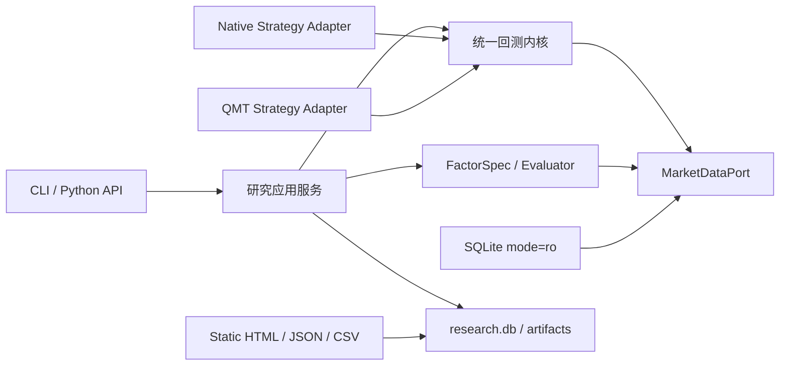

# 架构

DyadResearch 使用端口/适配器结构，依赖方向固定为：CLI 与报告 → 应用服务 → 研究/回测领域 → 数据端口。SQLite、原生策略和 QMT 风格策略都是边缘适配器。

领域内核只认识不可变 bar、订单、成交、持仓和事件，不认识 SQLite、pandas、QMT 或 DyadTetrade。货币运算使用 `Decimal`；时间在边界转换为 Asia/Shanghai 交易时间和 UTC epoch milliseconds。

`dyadresearch` 源码的静态导入扫描会拒绝 `dyadtetrade`、`xtquant.xttrader`、`XtTrader`、账户与实盘网关关键词。
